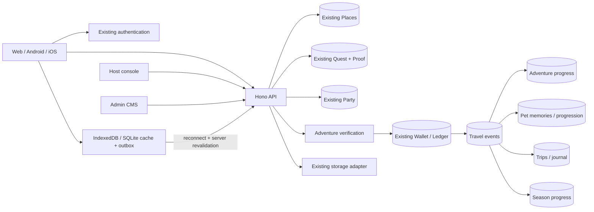

# ChivaGo Adventure Ecosystem — Implementation Report

Date: 2026-11-21

Scope: local development only, Phases 3–10

Release state: **PARTIALLY_COMPLETED** — implementation and automated/Web build verification pass; Android and iOS real-device UAT remain blocked pending physical devices.

## 1. Executive summary

ChivaGo now has one server-authoritative Adventure flow built on the existing Place, Quest, Party, Wallet/Ledger, Companion, Map and authentication systems. It does not create replacement engines.

```text
GPS / signed QR / evidence / host approval
                    ↓
            Verified Activity
                    ↓
       Existing Reward Ledger (idempotent)
                    ↓
              Travel Event
        ↙ Story ↙ Pet ↘ Journal ↘ Season
                    ↓
       Adventure and Party projections
```

Implemented locally:

- Static and dynamic signed QR, expiry, revocation, binding, usage history and replay protection.
- Adventure evidence photo upload, preflight validation, host-scoped review and audit trail.
- Server-owned verification policies for GPS, QR, evidence and host combinations.
- Pet EXP, bond, level, memories, gesture selection and costume preferences derived from verified events.
- Multi-trip Journal, verified entries, photos, cover, captions, ordering and privacy.
- Instance-isolated asynchronous Party Quest roster, assignment, contribution and team rewards.
- Adventure and Season CMS with draft/publish/archive or lifecycle validation and version-safe cloning.
- Seasonal quest progress, collection ownership and idempotent catch-up exchange.
- IndexedDB/SQLite Adventure cache and an offline outbox that never grants rewards locally.
- TH/EN/ZH API error contracts for all new backend error codes.

No commit, push, deployment, production migration or production environment change was performed.

## 2. Final architecture



Server trust boundaries:

- The authenticated server context supplies the user identity; user IDs, reward amounts and completion states are never trusted from the client.
- QR payload data is accepted only after signature, database state, binding, policy and replay checks.
- Evidence files do not become verification or rewards until the required policy reaches a server-confirmed terminal state.
- Ledger source references and unique constraints make reward retries idempotent.
- Offline records are pending claims only; the server revalidates them after reconnection.

## 3. Reused systems

| Existing system | Reuse |
|---|---|
| Authentication and device keys | Identity and ownership context for every Adventure operation |
| Places and MapLibre | Location records, coordinates, photography and map rendering |
| Check-in and geofence | GPS accuracy, mock-location and impossible-travel checks |
| Quest and proof review | Quest completion, evidence concepts and host review boundary |
| Party and Party live | Membership and collaboration base |
| Wallet and Ledger | All EXP, points and reward issuance/reversal |
| Companion and costume catalogues | Pet identity, assets and wearable ownership |
| Media/storage adapter | Evidence and Journal photos; no Base64 blobs in Adventure tables |
| Public cache/offline adapters | IndexedDB on Web and SQLite on native |
| Localization | Shared `Localised` values and locale resolver |

## 4. Database architecture

Schema version is **18**. Migrations are additive. The principal Adventure tables are:

- Narrative: `adventure_arcs`, `adventure_chapters`, `adventure_nodes`, `adventure_unlocks`, `adventure_content_versions`.
- Verification: `adventure_verification_policies`, `activity_qr_codes`, `activity_qr_scans`, `adventure_evidence`, `adventure_evidence_files`, `activity_verifications`, `activity_verification_audit`.
- Event projections: `travel_events`, `pet_memories`, `travel_journal_entries`, `pet_preferences`.
- Trips: `travel_trips`, `travel_trip_entries`, `travel_trip_photos`.
- Party: `party_quest_instances`, `party_quest_participants`, `party_quest_assignments`, with progress and Ledger source references isolated by instance.
- Season: `seasonal_events`, `seasonal_quest_bindings`, `seasonal_items`, `seasonal_progress_events`, `seasonal_item_ownership`, `seasonal_exchanges`.

Integrity controls include foreign keys, ownership filters, unique source references, idempotency keys, state checks, indexes for user/instance/status lookups and immutable audit rows. Account deletion now also removes or reattributes Party Quest assignments without deleting the remaining party's work.

## 5. API and console changes

Traveller APIs include:

- `GET /adventures/current`
- `POST /adventure/qr/verify`
- `GET /adventure/evidence`
- `POST /adventure/nodes/:id/evidence`
- `POST /adventure/evidence/:id/submit`
- `POST /adventure/evidence/:id/cancel`
- `GET /travel/events`, `GET /travel/journal`, `PATCH /travel/journal/:id`
- `GET/POST/PATCH /travel/trips...` and trip photo routes
- `GET /companions/memories`, progression and gesture routes
- `GET /seasons/current`, history/detail and item exchange
- Party Quest current/history/detail/progress/start/assignment/complete routes

Host/Admin console capabilities include:

- Evidence queue, evidence photo access, approve/reject and review history.
- QR creation/revocation and node verification policy management.
- Adventure draft creation, chapters, nodes, validation, publish/archive and clone-to-draft.
- Season creation, quest binding, collection item configuration and lifecycle changes.

All state-changing console routes require the existing authenticated session and CSRF token. Host evidence reads and decisions are scoped to the host's permitted location/activity.

## 6. Frontend screens

- `AdventureScreen`: home, chapter map, clue detail and server-confirmed unlock/reward result.
- `AdventureVerificationScreen`: scanner, permission/loading/offline/error/result states and evidence submission.
- `CompanionHome`: Pet progression, memories, gestures and wardrobe integration.
- `TravelJournalScreen`: trip list/detail, timeline, privacy and photo operations.
- Party screens: async quest overview, member contribution, assignment and reward summary.
- `SeasonScreen`: active season, progress, collection, exchange and history.

The screens retain the ChivaGo ocean/turquoise/tropical design, rounded cards and existing mascot/companion assets. They do not show completion before a server response.

## 7. Phase status

| Phase | Status | Result |
|---|---|---|
| 3 — Real-world verification | **COMPLETED (local)** | Signed QR, evidence, host approval, policy engine, Ledger and Travel Event integration |
| 4 — Pet progression | **COMPLETED (local)** | Server-derived EXP/bond/level/memory and supported gesture actions |
| 5 — Travel Journal | **COMPLETED (local)** | Multiple trips, photos, summaries, notes and private-by-default sharing |
| 6 — Party Adventure | **COMPLETED (local)** | Instance roster, async contribution, assignment and idempotent team reward |
| 7 — Adventure CMS | **COMPLETED (local)** | Draft/publish/archive, validation, audit and version-safe cloning |
| 8 — Seasons | **COMPLETED (local)** | Lifecycle, quest progress, collection and catch-up exchange |
| 9 — Offline | **COMPLETED (local)** | Cache/outbox/retry/conflict/server revalidation; no offline rewards |
| 10 — Security/integration | **PARTIALLY_COMPLETED** | Automated review, tests and Web export pass; physical Android/iOS UAT blocked |

## 8. Security assessment

A managed security scan of `apps/api` completed under scan ID `7ec69b00-e449-41da-b8f3-77b8e85b3736`. It reported two Medium findings, both remediated locally:

1. Evidence files could be stored before GPS/policy rejection. Submission now performs policy, ownership, geofence and cumulative-size preflight before storage and rolls back new files/rows if finalization fails.
2. Internal machine routes accepted weak shared secrets. They now require a minimum-strength secret, use timing-safe comparison, bound JSON bodies, and bind proof identity to the requested user and quest.

Additional hardening performed:

- Rejected QR attempts receive server-unique attempt IDs so a reused client request ID cannot bypass the rate limit.
- Season reward sources are deterministic and reversal recomputes ownership from all remaining valid progress.
- Adventure draft clone node IDs include chapter and node position, preventing cross-chapter collisions.
- Cache persistence failure cannot turn a successful live response into a false network failure.
- Every new static backend error code has exact TH/EN/ZH mobile copy; backend diagnostic text is not rendered to users.

Security scan artifacts:

- `C:/Users/ACER/.codex/state/plugins/codex-security/scans/api/unversioned_20261120T173328Z_7590e37e/report.md`
- `C:/Users/ACER/.codex/state/plugins/codex-security/scans/api/unversioned_20261120T173328Z_7590e37e/findings.json`

## 9. Test and build results

| Command | Result |
|---|---|
| `pnpm install --frozen-lockfile` | PASS — lockfile and dependencies consistent |
| `pnpm test` | PASS — all workspace suites; Core 1,095 and Mobile 925 tests shown in package summaries |
| `pnpm typecheck` | PASS — Core, Tokens, API and Mobile |
| `pnpm test:scripts` | PASS — 75/75 |
| `pnpm localization:check` | PASS — no new localization debt |
| Expo Web production export | PASS — 2,533 modules, output generated in a temporary local directory |
| Lint | NOT CONFIGURED — repository has no lint script |

The localization audit still reports the existing baseline of 244 legacy issues and 17 review candidates, but no new blocking issue was introduced.

## 10. UAT results

| Target | Status | Evidence |
|---|---|---|
| Web | **COMPLETED (build-level)** | Production export succeeded to `C:/Users/ACER/AppData/Local/Temp/chivago-web-uat-phase10-20261121` |
| Android physical device | **BLOCKED** | No physical Android device/session was available in this environment |
| iOS physical device | **BLOCKED** | No physical iOS device/session was available in this environment |

Physical-device UAT must cover camera permission, torch, QR focus, location permission/accuracy, photo capture/upload, airplane-mode outbox, app resume, background/foreground transitions and small-screen bottom navigation.

## 11. Known issues and remaining work

- High-value activities must keep using QR and/or Host approval because mock-location signals ultimately depend partly on device/OS reporting.
- If already-spent Memory Coins are later invalidated by reversal, the current balance safely clamps at zero and preserves the exchanged item's audit history. Product policy is still needed for debt or item reversal.
- Web's main generated bundle is approximately 7.39 MB; further route-level splitting and asset optimization are release-preparation work.
- React Native Web emits existing deprecation warnings for legacy shadow/pointer event props, and one map test reports a function-component ref warning.
- Android/iOS real-device UAT and visual screenshot comparison remain required before release.
- Production secret provisioning, backup, migration rehearsal and monitoring are intentionally not performed here.

## 12. Deployment preparation checklist

- [ ] Complete Android and iOS physical-device UAT.
- [ ] Run accessibility and screenshot comparison on the reference viewport set.
- [ ] Decide Season reversal/debt policy.
- [ ] Provision strong QR and host machine secrets in the target secret manager.
- [ ] Rehearse schema version 19 migration against a sanitized backup.
- [ ] Verify object-storage CORS, retention and deletion queue in staging.
- [ ] Validate rate limits and alerting under staging load.
- [ ] Review the 7.39 MB Web bundle and large image assets.
- [ ] Obtain explicit authorization before any commit, push, deploy or production migration.
