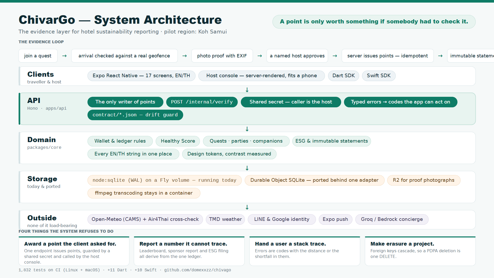

# 81 — The architecture diagram

One picture of the whole system, in both languages, for slides and for anyone
reading the repository for the first time.

- English — [SVG](assets/architecture/ChivarGo-architecture-en.svg) ·
  [PNG, 1920x1080](assets/architecture/ChivarGo-architecture-en.png)
- Thai — [SVG](assets/architecture/ChivarGo-architecture-th.svg) ·
  [PNG, 1920x1080](assets/architecture/ChivarGo-architecture-th.png)

## What it shows

Five layers — clients, API, domain, storage, outside feeds — the evidence loop
across the top, and the four things the system refuses to do along the bottom.
The API band is the only one drawn filled, because it is the only writer of
points and the diagram should say so before any label is read.

## Where the content came from

`README.md`, `docs/02-architecture.md`, `docs/71-moving-the-data-to-cloudflare.md`
and `docs/74-the-move-to-workers.md`, plus the package layout as it stands.

## What it is not

It is not generated from the code, so it will drift. Two things in it are
already newer than `docs/02-architecture.md`, which is worth knowing before
trusting either document on its own:

- `docs/02` says the app has 10 screens; the README says 17, and the diagram
  follows the README.
- `docs/02` draws Expo to Hono to SQLite and stops there. The diagram also
  carries the host console, both client SDKs, and the Cloudflare port
  (Durable Object SQLite behind one adapter, R2, the transcoding container)
  that `docs/74` records as done but deliberately not executed.

Regenerate by editing the diagram source rather than the SVG by hand, and
update `docs/02` in the same change whenever the two disagree.
